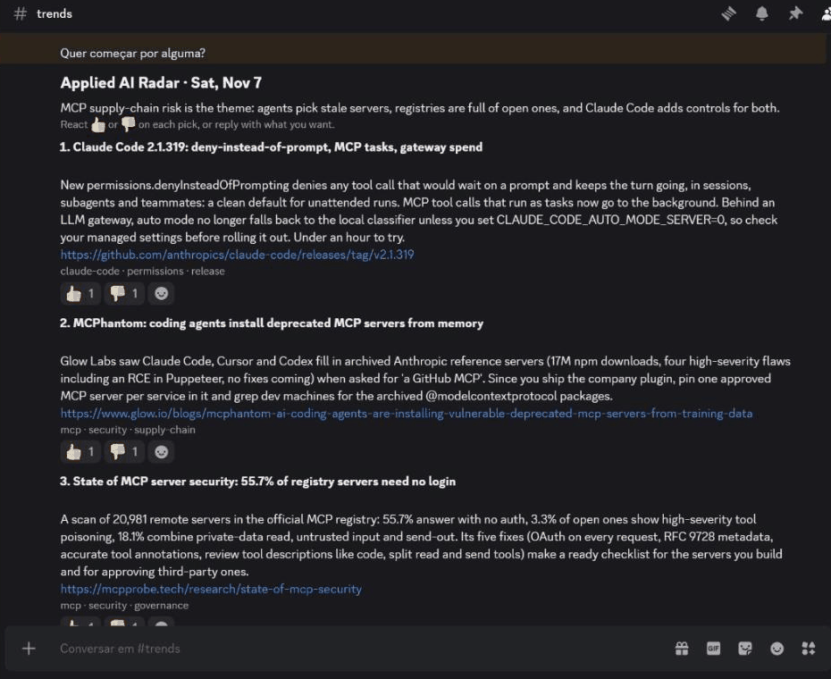

# Hermes Discord AI Agent

A [Hermes Agent](https://github.com/NousResearch/hermes-agent) setup that interviews you about your work and goals, then posts a daily **Radar** of applied-AI news to a Discord channel and learns from your 👍/👎 and your replies.

The Radar is the first Job; the agent is meant to take on more routines over time.



## How it works

```
                 ┌───────────── Hermes Agent ─────────────┐
 08:00 cron ───▶ │ daily-radar skill                      │
                 │  1. read your Reader profile           │
                 │  2. discord-agent radar feedback  ◀────┼──── your 👍/👎 on past Picks
                 │  3. discord-agent radar leads   ◀──────┼──── feeds, GitHub releases, Hacker News
                 │  4. pick, open and read each link      │
                 │  5. discord-agent radar post  ─────────┼───▶ #radar: header + one message per Pick
                 └────────────────────────────────────────┘
 your reply in #radar ───▶ radar-feedback skill ───▶ Reader profile
```

- **Hermes** does the thinking, the scheduling and the conversation on Discord. Its personality is [`prompts/SOUL.md`](prompts/SOUL.md), the file Hermes reads as its identity.
- **Three skills** (`skills/`) tell it how: `reader-interview`, `daily-radar`, `radar-feedback`.
- **`discord-agent`**, a small Python CLI, does the deterministic parts: collecting Leads, posting the Radar, reading reactions back. Each Pick is its own message so a reaction belongs to one Pick ([why the CLI posts instead of Hermes](docs/adr/0001-post-picks-through-discord-rest.md)).
- **One Docker image** holds all three: the official Hermes image plus this repo's skills and CLI ([`Dockerfile`](Dockerfile)). CI publishes it to `ghcr.io/natansalvadorligabo/hermes-discord-ai-agent`.
- **Your data** lives outside the repo, in the container's data directory (`/srv/hermes` on the VM): the Hermes config and `.env`, sessions, cron Jobs, and the Radar's files under `discord-agent/` (`reader-profile.md`, `sources.yaml`, `radar.json`).

The words used here (Reader, Lead, Pick, Verdict...) are defined in [GLOSSARY.md](GLOSSARY.md).

## Setup

The agent runs as a container on a small VM in **AWS** (EC2 `t3.small`, about US$15/month) or **GCP** (Free Tier `e2-micro`, US$0), and moves between them with one command. You need Linux (WSL on Windows) with [mise](https://mise.jdx.dev) and Docker, and a Discord server you manage.

### 1. Tools and a VM

```sh
git clone https://github.com/natansalvadorligabo/hermes-discord-ai-agent
cd hermes-discord-ai-agent
mise install                                      # uv, just, Terraform, AWS CLI at pinned versions
aws configure                                     # GCP: gcloud auth application-default login
ssh-keygen -t ed25519 -N "" -f ~/.ssh/hermes-vm   # the key the VMs trust
just up aws                                       # create the VM; GCP: set project in infra/gcp/terraform.tfvars
```

SSH to the VM is open only to the IP you applied from; run `just up` again when yours changes.

**On GCP**, the project needs an active billing account (the Free Tier requires one) and the [gcloud CLI](https://cloud.google.com/sdk/docs/install) for the login above. Copy `infra/gcp/terraform.tfvars.example` to `terraform.tfvars` and set `project`, and `billing_account` for an email at the first cent spent. Everything in `infra/gcp` stays inside the Free Tier, checked against Google's billing catalog: the external IPv4 is free for 721 hours a month and a month can have 744, so the VM stops every night from 03:00 to 05:00. Its IP changes after each stop; `just deploy`, `logs`, `move` and `down` read the new one, and `just refresh gcp` does it before a bare `just ssh gcp`.

### 2. Create the Discord bot

1. In the [Developer Portal](https://discord.com/developers/applications), create an application and a bot. Turn on the **Message Content** and **Server Members** intents.
2. Invite it with the recommended permissions: `https://discord.com/oauth2/authorize?client_id=<APP_ID>&scope=bot+applications.commands&permissions=309237763136`
3. Create the Radar channel (e.g. `#radar`) and copy its ID (Developer Mode, right-click, Copy Channel ID).

### 3. Configure Hermes on the VM

Start the agent once so Hermes creates its files, then open a shell on the VM:

```sh
just deploy aws
just ssh aws
```

Add to `/srv/hermes/.env`:

```sh
ANTHROPIC_API_KEY=...                   # or another provider Hermes supports
DISCORD_BOT_TOKEN=...
DISCORD_ALLOWED_USERS=<your Discord user ID>
DISCORD_HOME_CHANNEL=<Radar channel ID>
# discord-agent reads its own names: Hermes keeps DISCORD_* for the gateway and never passes
# DISCORD_BOT_TOKEN to tools, so the same token is stored again as RADAR_BOT_TOKEN.
RADAR_BOT_TOKEN=<the same bot token>
RADAR_CHANNEL_ID=<Radar channel ID>
RADAR_READER_ID=<your Discord user ID>      # only your reactions count
```

And to `/srv/hermes/config.yaml`:

```yaml
timezone: America/Sao_Paulo           # yours

skills:
  external_dirs:
    - /opt/hermes-discord-ai-agent/skills   # where the image keeps them

terminal:
  env_passthrough:                    # lets `discord-agent` post and read reactions
    - RADAR_BOT_TOKEN
    - RADAR_CHANNEL_ID
    - RADAR_READER_ID

discord:
  free_response_channels: ["<Radar channel ID>"]     # reply without @-mentioning the bot
  channel_prompts:
    "<Radar channel ID>": >
      This is the Radar channel. When the Reader writes about a Pick or the Radar,
      use the radar-feedback skill.
```

Then restart it from your machine: `just deploy aws`.

### 4. Get interviewed

Message the bot: _"Interview me for my Radar."_ The `reader-interview` skill asks about your work, goals, what you are learning, what to skip and how you want the Radar, writes your Reader profile, tunes your Sources and schedules the `daily-radar` Job.

To schedule it by hand instead: `discord-agent jobs command daily-radar --schedule "0 8 * * 1-5" --timezone <Area/City>` prints the `hermes cron create` line from [`jobs/daily-radar.yaml`](jobs/daily-radar.yaml).

## Teaching it

- **React** 👍 or 👎 on a Pick. Before each Radar, the agent reads your reactions from the last two weeks (only yours count) and writes the patterns it sees under `## Learned from feedback` in your profile.
- **Reply** in the Radar channel (_"more like #3"_, _"skip funding rounds"_). Words weigh more than reactions.
- **Edit** `/srv/hermes/discord-agent/reader-profile.md` or `sources.yaml` on the VM at any time; they are plain files.

## Commands

From your machine, in the repo:

| Command | What it does |
| --- | --- |
| `just up <cloud>` | Create the VM on `aws` or `gcp` and wait for Docker |
| `just deploy <cloud>` | Copy `compose.yaml` and `prompts/`, pull the latest image, (re)start the agent |
| `just move <from> <to>` | Stop the agent on one VM and start it, with all its data, on the other |
| `just switch <from> <to>` | `up <to>`, `move <from> <to>`, `down <from>` |
| `just down <cloud>` | Stop the agent, save the VM's data to `infra/.state-backups`, then destroy the VM |
| `just restore <cloud> <backup.tgz>` | Replace the VM's data with a backup from `down` and start the agent (after `just up`) |
| `just logs <cloud>` / `just ssh <cloud>` | Follow the agent's logs / a shell on the VM |
| `just refresh <cloud>` | Read the VM's current IP into Terraform's state (GCP's changes nightly) |

Only one VM should run the agent at a time, or the Radar posts twice. Why one Terraform root per cloud instead of a single toggle: [ADR 0002](docs/adr/0002-one-terraform-root-per-cloud.md). Why a merge to main reaches the VM only through `just deploy`: [ADR 0003](docs/adr/0003-deploy-by-hand-with-just-deploy.md).

Inside the container (`just ssh aws sudo docker exec hermes discord-agent ...`):

| Command | What it does |
| --- | --- |
| `discord-agent home` | Where your profile, Sources and Radar store live |
| `discord-agent sources init` | Copy the starting Sources to your home so you can edit them |
| `discord-agent radar leads` | Leads since the last Radar (36 hours to 7 days) never posted before, as JSON |
| `discord-agent radar post <draft.json>` | Post a Radar draft to the Radar channel |
| `discord-agent radar feedback [--window-days 14]` | Save your latest 👍/👎 and list every recent Pick you reacted to |
| `discord-agent jobs command <name> [--schedule] [--timezone]` | Print the `hermes cron create` line for a Job in `jobs/` |

## Develop

On Linux (WSL on Windows): the VMs and CI are Linux too.

```sh
mise install
uv sync
just check    # ruff, mypy --strict, pytest, terraform fmt and validate
just build    # the image, as CI builds it
```

In WSL, on a checkout under `/mnt/c`, set `UV_PROJECT_ENVIRONMENT=~/.venvs/hermes-discord-ai-agent` so the Linux venv does not replace the Windows `.venv`. Contributor and agent notes are in [AGENTS.md](AGENTS.md).

## License

[MIT](LICENSE)
